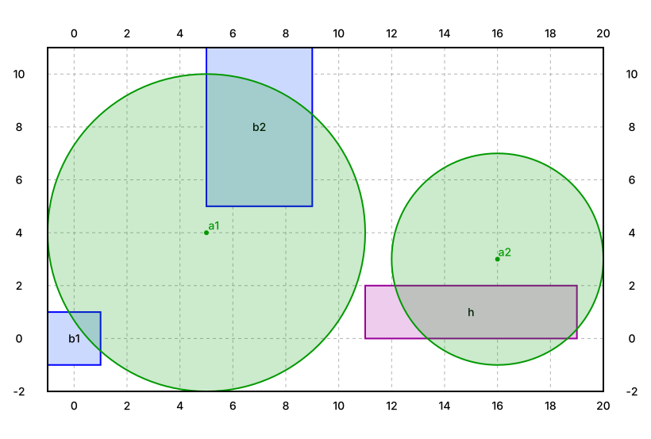

# kover


`kover` est un outil en ligne de commande, écrit en C, qui lit la description
d'une *scène* (des bâtiments, des maisons et des antennes de communication),
la valide, l'analyse et peut la dessiner en SVG.



*Image produite par `kover draw doc/scene.svg < examples/2b1h2a.scene`.*

## Fonctionnalités

- Validation stricte du format d'entrée, avec messages d'erreur précis
  (numéro de ligne, cause)
- Détection des chevauchements de constructions et des antennes superposées
- Calcul de la boîte englobante et de la **qualité de couverture** de chaque
  construction (de `A` à `E`, selon le nombre de coins couverts)
- Dessin de la scène en SVG avec [Cairo](https://www.cairographics.org/)
  (grille, graduations, constructions et antennes)
- Mémoire gérée dynamiquement : aucune limite sur le nombre d'objets
- Suite de tests automatisés avec [Bats](https://github.com/bats-core/bats-core)

## Installation

Dépendances : `gcc`, `make`, `pkg-config` et la bibliothèque de développement
Cairo (`libcairo2-dev` sous Debian/Ubuntu, `cairo` avec Homebrew).
[Valgrind](https://valgrind.org/) est facultatif, il sert aux tests de mémoire.

```sh
make          # produit bin/kover
make test     # lance les tests
make clean
```

## Utilisation

Toutes les sous-commandes lisent une scène sur l'entrée standard.

```sh
$ cat examples/2b1h2a.scene
begin scene
  building b1 0 0 1 1
  building b2 7 8 2 3
  house h 15 1 4 1
  antenna a1 5 4 6
  antenna a2 16 3 4
end scene
```

| Sous-commande   | Rôle                                          |
|:----------------|:----------------------------------------------|
| `bounding-box`  | Affiche la boîte englobante de la scène       |
| `describe`      | Décrit en détail le contenu de la scène       |
| `draw FICHIER`  | Dessine la scène dans un fichier SVG          |
| `help`          | Affiche l'aide                                |
| `quality`       | Donne la qualité de couverture de chaque construction |
| `summarize`     | Résume la scène                               |
| `validate`      | Indique si la scène est valide                |

```sh
$ kover bounding-box < examples/2b1h2a.scene
bounding box [-1, 20] x [-2, 11]

$ kover summarize < examples/2b1h2a.scene
A scene with 2 buildings, 1 house and 2 antennas

$ kover quality < examples/2b1h2a.scene
building b1: D
building b2: C
house h: D

$ kover draw scene.svg < examples/2b1h2a.scene   # crée scene.svg

$ kover validate < examples/first_line.invalid
not ok
error: first line must be exactly 'begin scene'
```

### Qualité de couverture

Une antenne couvre un point s'il est à une distance inférieure ou égale à sa
portée. La qualité d'une construction dépend du nombre de ses quatre coins
couverts : `A` (4), `B` (3), `C` (2), `D` (1), `E` (aucun).

## Format d'une scène

```
begin scene
  building ID X Y W H     # bâtiment centré en (X, Y), demi-largeur W, demi-hauteur H
  house    ID X Y W H     # maison, mêmes paramètres
  antenna  ID X Y R       # antenne centrée en (X, Y), de portée R
end scene
```

- Un **identifiant** respecte `[a-zA-Z_][a-zA-Z0-9_]*` et compte au plus
  10 caractères. Il est unique parmi les constructions, et parmi les antennes.
- `X` et `Y` sont des entiers ; `W`, `H` et `R` sont des entiers strictement
  positifs. Tous doivent tenir dans un `int`.
- Les champs sont séparés par des espaces ou des tabulations, et une ligne
  compte au plus 80 caractères.
- Deux constructions ne se chevauchent pas (avoir un côté ou un coin en commun
  est permis), et deux antennes n'occupent pas la même position.

Des exemples valides (`.scene`) et invalides (`.invalid`) sont dans
[`examples`](examples).

## Organisation du code

| Module         | Responsabilité                                              |
|:---------------|:------------------------------------------------------------|
| `kover`        | Point d'entrée, aiguillage des sous-commandes, aide         |
| `scene`        | Scène (tableaux dynamiques), chargement, validation, affichages |
| `construction` | Bâtiments et maisons : chevauchement, qualité de couverture |
| `antenna`      | Antennes : position, portée, couverture d'un point          |
| `parsing`      | Découpage d'une ligne en champs et conversion des nombres   |
| `validation`   | Règles de validité et messages d'erreur                     |
| `draw`         | Dessin SVG avec Cairo                                       |

`construction` et `antenna` ne dépendent pas de `scene`.

## Tests

```sh
make test
```

Les tests Bats (`bats/`) couvrent chaque sous-commande, les cas d'erreur, les
chevauchements, les grandes scènes et la gestion de la mémoire avec Valgrind
(ignorée si Valgrind n'est pas installé).

## Contexte

Ce projet a été réalisé dans le cadre du cours INF3135 *Construction et
maintenance de logiciels* (UQAM, hiver 2025). Le code de départ, les exemples
et la suite de tests initiale ont été fournis par le chargé de cours, Alexandre
Blondin Massé. Le découpage en modules `antenna` et `construction`, l'allocation
dynamique, la correction de la détection des chevauchements et la sous-commande
`draw` sont mon travail.
